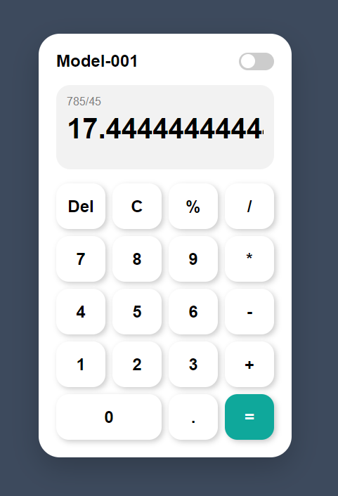
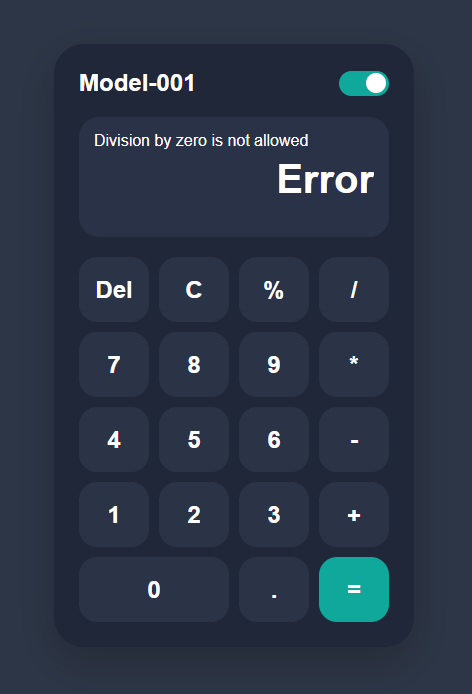

# 🧮 Modern Calculator

A clean and modern Calculator built using **HTML**, **CSS**, and **JavaScript**. This project features a beautiful neumorphic user interface, Light/Dark mode, and performs basic arithmetic operations with error handling.

---

## 📸 Preview

> Add screenshots here

### Light Mode


### Dark Mode


---

## ✨ Features

- ➕ Addition
- ➖ Subtraction
- ✖️ Multiplication
- ➗ Division
- 📊 Percentage Calculation
- 🔢 Decimal Number Support
- 🗑️ Delete (Del)
- 🧹 Clear (C)
- 🌗 Light/Dark Theme Toggle
- ⚠️ Division by Zero Error Handling
- 📱 Responsive Design
- 🎨 Modern Neumorphic UI

---

## 🛠️ Built With

- HTML5
- CSS3
- JavaScript (ES6)

---

## 📂 Project Structure

```
Modern-Calculator/
│
├── index.html
├── style.css
├── script.js
├── README.md
└── images/
    ├── light-mode.png
    └── dark-mode.png
```

---

## 🚀 Getting Started

### Clone the Repository

```bash
git clone https://github.com/yourusername/Modern-Calculator.git
```

### Open the Project

Open `index.html` in your web browser.

No installation or additional libraries are required.

---

## 📖 How to Use

1. Enter numbers using the calculator buttons.
2. Select an arithmetic operator (+, -, ×, ÷, %).
3. Press **=** to calculate the result.
4. Use **Del** to remove the last character.
5. Use **C** to clear the display.
6. Toggle the switch to change between Light and Dark mode.

---

## 🎯 Learning Objectives

This project helped me practice:

- HTML Layout Design
- CSS Grid
- Flexbox
- CSS Variables
- Neumorphism Design
- JavaScript DOM Manipulation
- Event Handling
- Calculator Logic
- Error Handling
- Theme Switching

---

## 📷 UI Inspiration

The calculator interface is inspired by modern neumorphic calculator designs with rounded buttons, soft shadows, and clean layouts.

---

## 🔮 Future Improvements

- Keyboard Support
- Calculation History
- Scientific Calculator Mode
- Memory Functions (M+, M-, MR)
- Sound Effects
- Animation Improvements
- Mobile Optimization

---

## 👨‍💻 Author

**Nadeesha Malshan**

Computer Science Undergraduate  
Aspiring AI Software Engineer  
Full-Stack Developer

GitHub: https://github.com/MalshanDev

---

## ⭐ Support

If you found this project helpful, consider giving it a ⭐ on GitHub.
